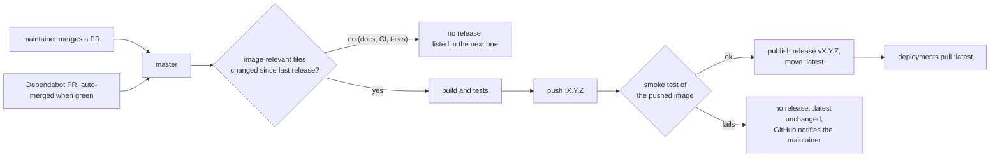

# Releasing ShareContainer

ShareContainer is released as a container image with [Semantic Versioning](https://semver.org) (0.x
before 1.0). **Every merge into `master` that changes the image is a release**. Merges that only touch
documentation or CI build nothing new; they are listed in the next real release. There is no manual
release step: merging a pull request is the approval. Updated distribution packages are released
without a pull request (see below).

## Images

| Tags | Base |
|---|---|
| `:latest`, `:X.Y.Z` | Debian |

The image is built for `linux/amd64` and `linux/arm64`.

## Workflows at a glance

| Workflow | File | Trigger | What it does |
|---|---|---|---|
| **Build** | `build.yml` | PR, push to `master` | Unit tests (coverage 100 %), smoke test over every protocol on `amd64` and `arm64`; on `master` a release if the image changed. |
| **Publish** | `publish.yml` | called by Build and Packages | Pushes both platforms, smoke-tests the pushed image, moves `:latest`, publishes the release. |
| **Packages** | `packages.yml` | daily | Rebuilds the image and compares all installed packages with `:latest`; a difference becomes a patch release. |
| **Release Drafter** | `release-drafter.yml` | PR events | Labels pull requests from their Conventional Commit titles. |
| **Dependabot** | `.github/dependabot.yml` | Dependabot schedule | Opens PRs for the base image and the GitHub Actions; they are merged automatically once the build is green. |

Image-relevant files are `src/`, `bin/` and the `Dockerfile`.

## Release flow

## Version numbers

The next version follows from the labels of the merged pull requests:

| Labels | Version step |
|---|---|
| `breaking`, `major` | major |
| `feature`, `enhancement` | minor |
| anything else (`fix`, `docs`, `chore`, `dependencies`, no label) | patch |

Labels are set automatically from Conventional Commit titles (`feat:`, `fix:`, `docs:`, ...).

## Dependency updates are released automatically

**An update of the base image or of a package in the image triggers a release on its own** (updates of
GitHub Actions only touch CI and do not). If you run `:latest` and redeploy regularly, you get it without
doing anything.

- **Base images:** Dependabot opens the pull request, it is merged automatically once the build and the
  smoke test pass, and the result is a new patch release.
- **Packages** (Samba and everything else installed from the distribution): Dependabot does not see
  them. A daily workflow builds the image and compares all installed package versions with those
  of the published image. Only if they differ, the new image is smoke-tested and published as a patch
  release that lists the package changes.

> **Risk:** if a dependency is itself vulnerable or compromised, that is shipped automatically as well,
> before anyone has looked at it.

What limits that risk:

- Dependabot checks **daily**, but waits **3 days** after a new version appears before proposing it
  (cooldown), so a compromised release that is found and pulled quickly never reaches ShareContainer.
  Security updates for known vulnerabilities are not delayed.
- Build images are pinned and only change through a reviewed-by-CI pull request.
- No release without a green build and smoke test.

If you want to control updates yourself, **pin a version tag** (`:X.Y.Z`) instead of `:latest` and
update deliberately after reading the release notes.

## New Debian release

The move to a new Debian release is a pull request of its own and at least a minor release, a major
release if the configuration format changes incompatibly. It usually brings a new Samba version.
**Back up the volumes before you update:** Samba migrates its databases forward, a rollback after that
is not guaranteed. To wait, pin the current version tag.

## Rollback

Version tags are never rebuilt. Pin the deployment to the version tag of an earlier release instead of
`:latest`, then switch back to `:latest` once a fixed release is published. The volumes stay as they
are; see above for a rollback across a Debian release.

## Deployment

ShareContainer only publishes images. Pulling `:latest` and redeploying the container is up to the
deployment, for example a scheduled stack redeploy. No credentials are needed: the repository and the
image are public.
